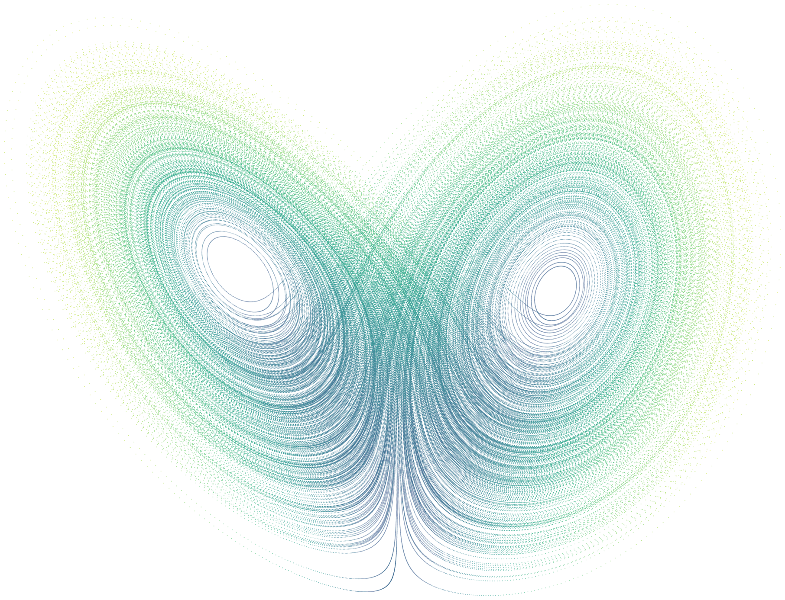

I like the perspective put forth in [The Silent Consensus](https://openai.com/index/the-silent-consensus/). The TL;DR is: most people actually want AI to enable us to make and think new things, not doomerism. In related news, a Substack I enjoy, Matt Schlosberg, also did [a post today](https://substack.com/home/post/p-225680648), reflecting on the same problem of "human reasoning obsolescence". It's [relatively easy](https://www.ndtv.com/artificial-intelligence/all-humans-will-become-unemployable-anthropic-researchers-warning-12344104) these days to feel very anxious about the pace of change and the future. I wanted to write down an uncharacteristically optimistic chain of thought I had.

**The gist of it is — a Gödelian critique of AGI post-anthropocene anxiety:**

- Yes, frontier models with a strong verifier can find solutions to problems that would exhaust all human reason.
- Yes, they often reason more accurately and faster than humans too.
- Yes, this will displace human effort in many presently existing types of work.
- Yes, opaque slop will be a problem.
- Yes, robotics is next; physical moats will also fall away.
- However, we live in a world which challenges the value of reason at every turn. This is the old physicist-turned-cabbie joke.
- In exchange for displacement, what we might get is actually an opportunity to understand things better than we ever did before (yes, us — humans).
- The most powerful and valuable outcomes of reasoning are probably those which, once obtained, are easy enough for even a meatbag human to understand.

Gödel showed that there are true statements our system of mathematical logic (which AI cannot transcend either) cannot prove are true.

The average person interacts with about 1000 systems a day that they don't understand, and whose makers didn't understand either, but found empirically. Drugs are a great example (Metformin: how does that work?). AI itself is another. It has been developed almost entirely empirically, rather than through theoretical insight. Even something as simple as the bicycle was not really designed with reason, and was the topic of [academic study recently](https://www.cbc.ca/news/science/science-of-cycling-still-mysterious-1.3699012).

What AI allows is a very rapid reduction of a mechanism into de-jargonized, easily understood reasoning, if you use it right. Many critical features of our world, and recent discoveries, when explained well, are simple. This is the basis of the famous standard of elegance in physics. There will definitely be cases like the Navier–Stokes proof dump, where AI (with strong verifiers) makes an inscrutable web of logic. However, we already know that many essential features of our physical world, in which work is done, are beyond logic. The deeper the chain of reasoning, the geometrically less likely it is that the reasoning is productive in our chaotic reality, a reality in which the uncertainty principle cannot be violated.

**I think it's possible that, actually, post-anthropocene humans understand more, and use reason more, than they did before.**

Let's call it the "you learn more in the classroom with all the other smart kids" effect. The tricky thing is, this optimistic vision is only possible if people remain CURIOUS about their world. If they have a DESIRE to understand. I have built my entire career on computers, yet a year ago I could not design a circuit very well. Today I can do it effortlessly, with Claude's help — and yes, really understand it.

As a young man I studied music theory, guitar, and bassoon. I could rattle off what an Ionian fifth was, and play written music, but I was never able to make two bars of song I didn't hate until the [FM-1](https://arstechnica.com/gadgets/2026/10/from-impulse-purchase-to-pocket-studio-the-m-vave-fm-1/).

It's a vibecoded music tool that lets people understand groove-making better than I ever did before — and probably the first example of something I have held and loved that was made by AI.

We already know, thanks to Gödel, that there are true statements no frontier model could prove were true. We know there are important physical phenomena, like the weather, which will defy deep understanding from models and humans alike — no matter what. We even know that the smartest humans, capable of the greatest feats of reason, can often do less with that reasoning than a plumber. A quippy version of this I've said before is: "Imagine Einstein were visiting this drug company; he couldn't help much."

I think this is the productive version of the mathematician's angst over Lean-maxxed slop-proofs. In their guts, they know a proof that cannot be distilled into insights easier to understand than the chaos of the algorithm has much less value.

Go out there and use AI to understand your world. Distill it into beautiful abstractions. You don't really have any other choice, and you will end up sitting next to a robot debating whether the [Lorenz attractor](https://en.wikipedia.org/wiki/Lorenz_system) goes left or right next time anyway.

\- John
